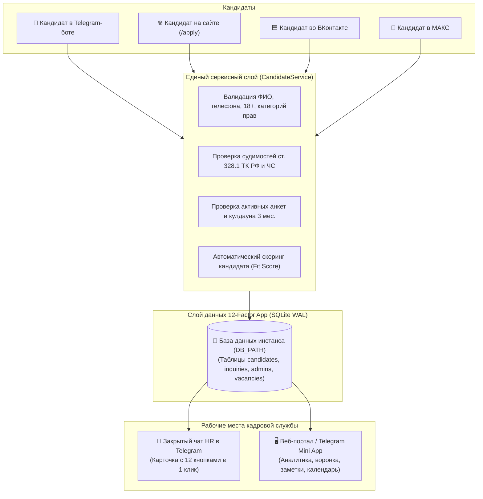

<div align="center">

# 🚋 UETBot — Омниканальная цифровая экосистема МУП «Ульяновскэлектротранс»

**Единая платформа подбора персонала, 16-шаговая анкета соискателя, интерактивный HR-пульт в Telegram, Web-портал и Mini App, омниканальный мост (TG / VK / MAX), архитектура 12-Factor App и строгий контур безопасности 152-ФЗ РФ.**

[](https://github.com/gamedich/uetbot/tree/main)
[](https://t.me/UetFeedback_bot)
[](https://gamedich.github.io/uetbot/)
[](https://www.python.org/)
[](https://docs.aiogram.dev/)
[](https://docs.aiohttp.org/)
[](https://www.sqlite.org/)
[](#-соответствие-законодательству-рф-152-фз-и-тк-рф)
[](#-тестирование)

[🤖 Бот в Telegram: @UetFeedback_bot](https://t.me/UetFeedback_bot) •
[🌐 Интерактивная презентация (GitHub Pages)](https://gamedich.github.io/uetbot/) •
[Ключевые возможности](#-ключевые-возможности) •
[Единый контур: Бот + Веб](#-единый-контур-данных-сайт-и-бот--это-одна-анкета) •
[16 шагов анкеты](#-16-шаговая-анкета-соискателя) •
[152-ФЗ и Безопасность](#-соответствие-законодательству-рф-152-фз-и-тк-рф) •
[Быстрый старт](#-быстрый-старт-и-деплой)

</div>

---

## 📌 О проекте

**UETBot** — специализированная цифровая система массового подбора и координации кадров для ведущего муниципального перевозчика города Ульяновска — **МУП «Ульяновскэлектротранс»**.

Система автоматизирует первичную воронку найма, полностью освобождает сотрудников отдела кадров от рутинного ручного сбора данных и объединяет входящий поток соискателей из **Telegram**, сообщества **ВКонтакте**, корпоративного мессенджера **МАКС (VK Teams)** и **официального веб-сайта предприятия** в единый контур управления.

---

## 🌐 Единый контур данных: Сайт и Бот — это одна анкета?

> **Ответ: ДА, абсолютно!**  
> В системе реализован принцип **Single Source of Truth (SSOT)**: веб-форма (`/apply`) и анкета в боте полностью синхронизированы и неразделимы.



### Преимущества сквозной синхронизации:
1. **Идентичная структура:** Кандидат заполняет ровно те же **16 юридически выверенных полей** как на сайте, так и в чат-боте.
2. **Мгновенный тикет в Telegram:** Как только соискатель нажимает «Отправить анкету» на веб-странице, в кадровый чат Telegram мгновенно прилетает карточка с номером тикета `#{ID}` и полным набором интерактивных кнопок быстрых действий.
3. **Единый трекинг статуса:** Соискатель может подать анкету через веб-сайт, а затем открыть бота и по команде `/my` или `/status` видеть актуальный статус заявки (*«Новая»*, *«В работе»*, *«Приглашен»*, назначенное время очного собеседования).
4. **Сквозной Live-чат:** Если кандидат пишет через бота, кадровик может вести диалог в Telegram или просматривать историю в веб-панели.

---

## ✨ Ключевые возможности системы

* 🔄 **Омниканальный мост:** Интеграция 4 каналов: **Telegram Bot API**, **VK LongPoll Community API**, **MAX Gateway** и **Web-портал на базе Aiohttp**.
* 📋 **Интерактивная 16-шаговая анкета:** С поддержкой кнопочного выбора, ручного ввода, навигации `/back` (назад) и `/skip` (пропустить).
* 🎓 **Умный триггер «Бесплатное обучение со стипендией»:** Если соискатель выбирает водительскую специальность без опыта работы, система автоматически презентует программу бесплатного обучения в депо с гарантией трудоустройства.
* 🛡️ **Полное соответствие 152-ФЗ РФ и ТК РФ:** Цифровой акцепт согласия (Шаг 0), выгрузка персональных данных соискателю (`/mydata`), право на отзыв согласия (`/revoke`) с автогенерацией акта уничтожения, 6-месячный лимит хранения.
* ⚖️ **Compliance-контроль ст. 328.1 ТК РФ:** Экспресс-анализ судимостей соискателей на должности водителей пассажирского транспорта непосредственно при подаче.
* 🏢 **Календарь очных собеседований:** Назначение даты, времени и локации встречи (ул. Гончарова, 2) с авто-уведомлением кандидата.
* 📊 **Веб-дашборд и Mini App (TMA):** KPI-счётчики (Новые, В работе, Приглашены, Тестовые), фильтрация по статусам и базам, поиск соискателей, переключатель открытых вакансий (`vacancies.json`).
* 💾 **Горячие бэкапы (24 ч):** Резервное копирование SQLite без блокировки чтения/записи с глубиной хранения 7 архивов.

---

## 🔄 16-шаговая анкета соискателя

Анкета разработана в строгом соответствии с кадровым регламентом МУП «Ульяновскэлектротранс»:

| Шаг | Наименование шага | Тип ввода / Валидация | Поведение и триггеры |
|:---:|:---|:---|:---|
| **0** | **Согласие 152-ФЗ** | Inline-кнопки | `✅ Даю согласие`, `❌ Не даю согласие`, `📄 Политика`. Фиксация даты/времени согласия. |
| **1** | **ФИО соискателя** | Текст (ручной ввод) | Проверка: минимум 2 слова, только буквы и дефис, автокапитализация. |
| **2** | **Дата рождения** | Кнопки годов / Вручную | Валидация `ДД.ММ.ГГГГ` и строгая проверка совершеннолетия (18+ по ТК РФ). |
| **3** | **Контактный телефон** | Кнопка контакта / Вручную | Приведение к федеральному формату `+7XXXXXXXXXX`. |
| **4** | **Город проживания** | Кнопки / Свой вариант | Ульяновск, Димитровград, Новоульяновск, Барыш или ввод любого города. |
| **5** | **Желаемая вакансия** | Список из `vacancies.json` | Водитель трамвая, водитель троллейбуса, кондуктор, слесарь, электромонтёр или 5.1 «Другая должность». |
| **6** | **Водительское удостоверение** | Да / Нет | При «Да» — мультивыбор категорий: `A`, `B`, `C`, `D`, `E`, `Трамвай`, `Троллейбус`. |
| **7** | **Опыт работы по профилю** | Да / Нет | При «Да» — описание стажа. При «Нет» — срабатывает триггер на **обучение со стипендией**. |
| **8** | **Уровень образования** | Кнопки + учебное заведение | Среднее, СПО, Неоконченное высшее, Высшее, степень + ввод учебного заведения. |
| **9** | **Готовность к переезду** | Да / Нет / Условия | Фиксация готовности к переезду в г. Ульяновск и условий. |
| **10** | **Общежитие предприятия** | Да / Нет / Комментарий | Потребность в месте в общежитии или программе компенсации жилья. |
| **11** | **Сменный график работы** | Да / Нет / Предпочтения | Готовность к ранним/вечерним сменам 2/2 или по графику депо. |
| **12** | **Медицинские противопоказания**| Да / Нет / Описание | Ограничения по здоровью (зрение, слух, физические нагрузки). |
| **13** | **Сведения о судимости** | Да / Нет / Описание | Проверка по ст. 86 УК РФ и ст. 328.1 ТК РФ для водительского состава. |
| **14** | **Источник информации** | Кнопки / Вручную | Сайт, Telegram, ВКонтакте, МАКС, ЦЗН, знакомые или свой вариант. |
| **15** | **Дополнительные сведения** | Текст / «⏭ Пропустить» | Награды, курсы, знание языков, особые технические навыки. |
| **16** | **Сводка и подтверждение** | Проверка карточки | Сводное досье перед отправкой. Возможность точечно отредактировать любое поле. |

---

## 🎯 Интерактивный пульт кадровой службы Telegram (3×4)

Каждый тикет кандидата, поступающий в кадровый чат, оснащён эргономичной сеткой быстрых действий **3 × 4**:

```text
┌─────────────────┬─────────────────┬─────────────────┐
│   📞 Телефон    │   🟢 Live-чат   │   💬 Написать   │  <- Ряд 1: Оперативная связь
├─────────────────┼─────────────────┼─────────────────┤
│   📂 В работу   │  🟢 Пригласить  │    🔴 Отказ     │  <- Ряд 2: Воронка статусов
├─────────────────┼─────────────────┼─────────────────┤
│   🏢 Встреча    │ 🔍 Риски ТК РФ  │   📝 Заметка    │  <- Ряд 3: Проверка и интервью
├─────────────────┼─────────────────┼─────────────────┤
│   🌐 На сайте   │     ⛔ В ЧС     │    🗑 Удалить   │  <- Ряд 4: Веб и управление
└─────────────────┴─────────────────┴─────────────────┘
```

* **`📞 Телефон`** — системный alert с номером телефона кандидата и ФИО для быстрого набора или копирования в 1 клик.
* **`🟢 Live-чат`** — запуск прямого сквозного диалога между кадровиком и соискателем в чате.
* **`💬 Написать`** — отправка разового персонального сообщения соискателю от имени отдела кадров.
* **`📂 В работу` / `🟢 Пригласить` / `🔴 Отказ`** — мгновенное обновление статуса заявки в БД с авто-уведомлением кандидата.
* **`🏢 Встреча`** — мастер выбора слота и назначения даты очного собеседования в отделе кадров (ул. Гончарова, д. 2).
* **`🔍 Риски ТК РФ`** — автоматический аудит соответствия ограничениям ст. 328.1 ТК РФ.
* **`📝 Заметка`** — добавление внутренней служебной заметки кадровика, видимой на веб-дашборде.
* **`🌐 На сайте`** — прямая ссылка на карточку соискателя в защищённой веб-панели управления.
* **`⛔ В ЧС`** — внесение спамера или недобросовестного соискателя в черный список с блокировкой повторных заявок.
* **`🗑 Удалить`** — уничтожение анкеты с автоматическим протоколированием акта уничтожения ПДн по ст. 21 152-ФЗ.

---

## 🛡 Соответствие законодательству РФ (152-ФЗ и ТК РФ)

Система изначально спроектирована с учётом нормативных требований законодательства Российской Федерации:

1. **Федеральный закон № 152-ФЗ «О персональных данных»:**
   * **Ст. 9 (Согласие):** Полноценное предварительное согласие (Шаг 0) с фиксацией оператора (МУП «Ульяновскэлектротранс», ИНН 7325000960), целей обработки и перечня данных.
   * **Ст. 14 (Права субъекта):** Команда `/mydata` выгружает кандидату все обрабатываемые предприятием сведения.
   * **Ст. 21 (Отзыв согласия):** Команда `/revoke` позволяет соискателю в любой момент отозвать согласие с автоматической генерацией электронного акта уничтожения.
   * **Срок хранения (6 месяцев):** Фоновый воркер ежедневно проверяет даты анкет и безвозвратно удаляет данные с истекшим сроком хранения.
2. **Федеральный закон № 149-ФЗ:** Локализация баз данных строго на серверах на территории РФ.
3. **Трудовой кодекс РФ (ст. 86–88, 328.1):** Обработка данных исключительно для целей трудоустройства и автоматическая верификация ограничений для водителей пассажирского транспорта.

---

## 📋 Полный справочник команд

### 👤 Для соискателей
| Команда | Алиасы | Назначение |
|---|---|---|
| `/start`, `/menu` | — | Открытие главного интерактивного меню |
| `/apply` | `/job`, `/rabota`, `/anketa` | Запуск 16-шаговой анкеты соискателя |
| `/my` | `/status`, `/stat` | Проверка текущего статуса поданной заявки |
| `/training` | `/obuchenie` | Условия бесплатного обучения на водителя со стипендией |
| `/privacy` | `/policy` | Политика обработки персональных данных (152-ФЗ) |
| `/mydata` | — | Выгрузка персональных данных, хранящихся у оператора |
| `/revoke` | — | Отзыв согласия и безвозвратное уничтожение анкеты |
| `/stop` | — | Завершение прямого Live-диалога с сотрудником отдела кадров |
| `/cancel` | `отмена` | Прерывание текущего шага опроса и возврат в меню |
| `/back` | — | Возврат на предыдущий шаг заполнения анкеты |
| `/skip` | — | Пропуск необязательного шага анкеты |
| `/ask` | `/question` | Отправка обращения или вопроса специалисту отдела кадров |
| `/faq` | `/voprosy` | Частые вопросы (зарплата, льготы, график, жилье) |
| `/contacts`| `/contact` | Адрес, телефоны и режим работы отдела кадров |
| `/help` | `помощь`, `справка` | Полный интерактивный справочник команд |

### 👨‍💼 Для сотрудников отдела кадров (HR)
| Команда | Назначение |
|---|---|
| `/hr` | Кадровая панель управления, статистика и списки |
| `/export` | Выгрузка реестра кандидатов в Excel / CSV |
| `/set_group` | Привязка рабочего чата для получения анкет |
| `/sync` | Двусторонняя синхронизация списка кадровиков группы |
| `/kick` | Исключение сотрудника из чата и отзыв роли (ответом на сообщение) |
| `/note <id> <текст>` | Добавление служебной заметки к анкете соискателя |
| `/ban <id>` / `/unban <id>` | Управление черным списком соискателей |

### 🛠 Для технических администраторов и инженеров (Tech / SuperAdmin)
| Команда | Назначение |
|---|---|
| `/panel`, `/web` | Ссылка на защищённый веб-портал управления / Mini App |
| `/password <пароль>`| Установка или смена личного пароля для входа в веб-панель |
| `/tech` | Панель мониторинга: нагрузка на CPU, RAM, статус шлюзов, аптайм |
| `/tests` | Меню тестовых анкет (эмуляция откликов Telegram, VK, Web) |
| `/backups` | Ручное создание, список и выгрузка горячих копий SQLite |
| `/restore` | Откат базы данных к резервной копии |
| `/logs` | Оперативный журнал событий (последние 20 записей) |
| `/admins` | Реестр администраторов с ролевой моделью |
| `/add_hr <id>` / `/add_tech <id>` | Назначение прав доступа |
| `/panel` | Открытие веб-панели управления (Mini App) |
| `/restart` | Безопасный перезапуск системной службы `uet_bot.service` |

---

## 📂 Структура проекта (v2.0 Modular Architecture)

```text
/root/uetbot/
├── bot.py                  # Главная точка входа: Dispatcher, регистрация шлюзов и воркеров
├── config.py               # Конфигурация 12-Factor App: безопасная загрузка .env, строгая валидация типов
├── database.py             # Слой данных: SQLite (WAL), пул соединений, scrypt-хеширование
├── common.py               # Общие сервисы: ролевая модель, bot commands, safe_send
├── keyboards.py            # Разметка клавиатур: сетка 3×4 для HR, 16 шагов, главное меню
├── texts.py                # Единая текстовая карта бота (Single Source of Truth)
├── web_app.py              # Веб-сервер Aiohttp: REST API, личный кабинет, дашборд
│
├── core/                   # Ядро системы
│   ├── storage.py          # Персистентное FSM-хранилище SQLiteFSMStorage
│   ├── logging.py          # In-memory кольцевой буфер и структурированное логгирование
│   └── commands.py         # Регистрация и синхронизация команд Telegram Bot API
│
├── repositories/           # Модульный слой данных (Repository Mixins)
│   ├── schema.py           # DDL-схема таблиц, миграции и сидирование справочников
│   ├── candidate_repo.py   # Реестр соискателей, поиск, аудит 152-ФЗ, скоринг
│   ├── inquiry_repo.py     # Обращения кандидатов и журнал live-диалогов
│   ├── vacancy_repo.py     # Синхронизация открытых/закрытых вакансий
│   └── admin_repo.py       # RBAC-управление администраторами и правами доступа
│
├── handlers/               # Модульные обработчики Telegram (aiogram 3)
│   ├── candidate.py        # 16-шаговая анкета, Live-чат, права 152-ФЗ, фолбэки
│   ├── tech.py             # Инженерная панель, мониторинг, бэкапы, перезапуск
│   └── hr/                 # Кадровый модуль
│       ├── panel.py        # Статистика, фильтры, списки
│       ├── tickets.py      # Обработка тикетов в группе, собеседования, ТК РФ
│       ├── access.py       # Управление правами, синхронизация группы, ЧС
│       └── export.py       # Выгрузка отчетов и экспорт реестров по ГОСТ
│
├── services/               # Бизнес-логика (не зависит от транспорта)
│   ├── candidate_service.py # Валидация ФИО, телефона, 18+, регистрация анкет, Fit Score
│   ├── compliance_service.py # Анализ рисков ст. 328.1 ТК РФ, проверка прав
│   └── interview_service.py # Слоты и календарь собеседований
│
├── web/                    # Веб-платформа и REST API
│   ├── routes/             # Модульные HTTP-хэндлеры
│   │   ├── admin.py        # Управление системой, бэкапы, рассылки, ТО
│   │   ├── auth.py         # Безопасная аутентификация, scrypt, 2FA OTP
│   │   ├── candidates.py   # API соискателей, воронка, статусы
│   │   ├── inquiries.py    # Вопросы и обращения кандидатов
│   │   └── pages.py        # Рендеринг HTML-страниц и статики
│   ├── middlewares.py      # Аудит запросов, rate limit, CORS
│   └── security.py         # HMAC-SHA256 токены, сессии
│
├── gateways/               # Омниканальные шлюзы
│   ├── vk_gateway.py       # Шлюз группы ВКонтакте (LongPoll API)
│   └── max_gateway.py      # Шлюз мессенджера МАКС / VK Teams
│
├── templates/              # HTML5-шаблоны веб-портала (Vanilla CSS, Responsive 8px, Dark Mode)
│   ├── dashboard.html      # Дашборд HR: KPI, карточки, воронка, заметки
│   ├── apply.html          # Онлайн-анкета соискателя (16 шагов в веб)
│   └── login.html          # Защищённая страница авторизации
│
├── tests/                  # Автоматические тесты (Pytest, CI Isolation)
│   ├── conftest.py         # Фикстуры изоляции окружения (:memory: и tmp_path)
│   ├── test_candidate_service.py # Тесты валидации полей и бизнес-правил
│   ├── test_password_security.py # Тесты scrypt-хеширования и прозрачной миграции
│   └── test_database_isolation.py# Тесты изоляции БД и 12-Factor архитектуры
│
├── scripts/                # Инженерные утилиты и сборка
│   ├── build_portal.py     # Сборка и минификация веб-портала
│   └── check_db.py         # Диагностика целостности SQLite
│
└── data/                   # Локальное хранилище данных (не отслеживается в Git)
    ├── .gitkeep            # Фиксация каталога в Git без коммита баз данных
    └── vacancies.json      # Реестр открытых и закрытых вакансий (SSOT)
```

---

## 🚀 Быстрый старт и деплой

### 1. Системные требования
* **ОС:** Linux (Ubuntu 22.04 / 24.04 LTS / Debian 12)
* **Python:** `3.11` или выше
* **SQLite:** 3.35+ (с поддержкой WAL-режима)

### 2. Клонирование и установка зависимостей
```bash
git clone https://github.com/gamedich/uetbot.git
cd /root/uetbot
python3 -m venv venv
source venv/bin/activate
pip install --upgrade pip
pip install -r requirements.txt
```

### 3. Настройка окружения (`.env`)
Создайте файл `.env` на основе примера [.env.example](file:///root/uetbot2/.env.example):
```ini
ENVIRONMENT=PROD

# База данных SQLite (12-Factor App)
# Для PROD: data/resumes.db, для DEV: data/dev.db
DB_PATH=data/resumes.db

# Telegram Bot
BOT_TOKEN=8880412470:AAH...
SUPER_ADMIN_ID=7657422832
TECH_ADMIN_ID=7657422832
HR_GROUP_ID=-1003875480349

# ВКонтакте (Сообщество)
VK_GROUP_TOKEN=vk1.a...
VK_GROUP_ID=241536798

# Корпоративный мессенджер МАКС / VK Teams
MAX_BOT_TOKEN=
MAX_API_BASE=https://api.myteam.mail.ru/bot/v1

# Встроенный веб-портал и Mini App
WEB_APP_HOST=0.0.0.0
WEB_APP_PORT=8080
WEB_APP_URL=https://213.226.124.135.sslip.io/

# Данные организации
HR_PHONE=+7 (8422) 58-46-60
HR_ADDRESS=г. Ульяновск, ул. Гончарова, д. 2
HR_SCHEDULE=Пн–Пт с 8:00 до 17:00 (обед 12:00–13:00)
```

### 4. Управление системной службой (systemd)
Служба `/etc/systemd/system/uet_bot.service`:
```bash
# Перезапуск службы
systemctl restart uet_bot.service

# Просмотр статуса
systemctl status uet_bot.service

# Чтение логов в реальном времени
journalctl -u uet_bot.service -f
```

---

## 🧪 Тестирование

Проект покрыт автоматическим комплексом тестов на базе `pytest` с полной изоляцией баз данных:
```bash
/root/uetbot/venv/bin/pytest tests/ -v
```
```text
============================= test session starts ==============================
collected 16 items

tests/test_candidate_service.py::TestCandidateValidation::test_validate_fio_valid PASSED
tests/test_candidate_service.py::TestCandidateValidation::test_validate_fio_invalid PASSED
tests/test_candidate_service.py::TestCandidateValidation::test_validate_phone_normalization PASSED
tests/test_candidate_service.py::TestCandidateValidation::test_validate_phone_invalid PASSED
tests/test_candidate_service.py::TestCandidateValidation::test_validate_birth_date_adult PASSED
tests/test_candidate_service.py::TestCandidateValidation::test_validate_birth_date_underage PASSED
tests/test_candidate_service.py::TestCandidateValidation::test_validate_question PASSED
tests/test_candidate_service.py::TestCandidateValidation::test_is_driver_vacancy PASSED
tests/test_candidate_service.py::TestCandidateValidation::test_calculate_applicant_score PASSED
tests/test_database_isolation.py::TestDatabaseIsolation::test_memory_database_initialization PASSED
tests/test_database_isolation.py::TestDatabaseIsolation::test_tmp_path_database_isolation PASSED
tests/test_database_isolation.py::TestDatabaseIsolation::test_no_database_files_created_in_repo_root_or_untracked PASSED
tests/test_password_security.py::TestPasswordSecurity::test_scrypt_hash_generation PASSED
tests/test_password_security.py::TestPasswordSecurity::test_verify_password_correct PASSED
tests/test_password_security.py::TestPasswordSecurity::test_verify_password_wrong PASSED
tests/test_password_security.py::TestPasswordSecurity::test_legacy_plaintext_migration_compatibility PASSED

============================= 16 passed in 30.07s ==============================
```

---

<div align="center">

**МУП «Ульяновскэлектротранс»**  
г. Ульяновск, ул. Гончарова, д. 2 • Телефон отдела кадров: **8 (8422) 58-46-60**  
*Официальная разработка и сопровождение: 2026*

</div>