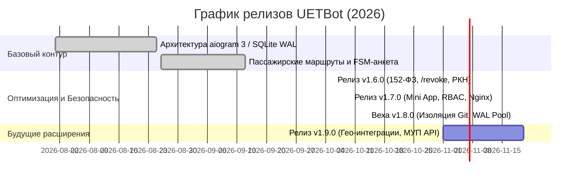

# Product Requirements Document (PRD): Цифровой сервис МУП «Ульяновскэлектротранс» (UETBot)

## 1. Overview
Продукт **UETBot** — официальный омниканальный пассажирский и кадровый сервис Муниципального унитарного предприятия «Ульяновскэлектротранс» (МУП «УЭТ») на базе Python 3.12, aiogram 3.x, SQLite (WAL-режим) и aiohttp. Сервис предоставляет жителям и гостям города оперативный доступ к расписаниям трамваев и троллейбусов, оповещениям об оперативных изменениях маршрутов, подаче обращений/жалоб/предложений, а также автоматизирует защищённый контур набора персонала электротранспорта (водителей, кондукторов, слесарей подвижного состава) в строгом соответствии с 152-ФЗ РФ.

---

## 2. Goals and Non-Goals

### Goals (В скоупе проекта):
1. **Информирование пассажиров:** Предоставление актуальных маршрутов, интервалов движения и расписания трамвайных и троллейбусных маршрутов г. Ульяновска.
2. **Оперативные дорожные оповещения:** Мгновенное уведомление пассажиров об авариях, ремонтах путей, обрывах контактной сети и временных изменениях схем движения.
3. **Обратная связь и жалобы:** Приём обращений пассажиров по работе подвижного состава, культуре обслуживания и забытым вещам с передачей в диспетчерскую службу.
4. **Кадровый контур МУП УЭТ:** 16-шаговое анкетирование соискателей на должности водителей электротранспорта, кондукторов и ремонтного персонала.
5. **Соответствие 152-ФЗ РФ и ТК РФ:** Электронное согласие на обработку ПДн, проверка ограничений ст. 328.1 ТК РФ, автоматическое уничтожение данных с формированием актов по Приказу РКН №179.
6. **Высокая доступность:** Поддержка 99.5% аптайма и задержка отклика (latency) менее 200 мс.

### Non-Goals (Вне скоупа):
1. Встроенный процессинг безналичной оплаты проезда (оплата осуществляется штатными валидаторами транспортных карт и терминалами в салоне).
2. Прямое GPS-трекирование в реальном времени каждого вагона на карте внутри Telegram (пассажир направляется на картографические геосервисы).
3. Доступ к терминалу сервера или командам управления версиями (Git) через мессенджер либо публичный веб-интерфейс — весь контур управления инфраструктурой изолирован на сервере.

---

## 3. User Personas

### Персона 1: Пассажир транспорта — Алексей, 34 года (Ежедневный пассажир)
- **Контекст:** Ежедневно добирается на работу из Засвияжского района в центр на трамвае №22 или №4.
- **Потребности:**
  - Быстро узнать, когда прибудет следующий трамвай на нужную остановку.
  - Получить мгновенное push-уведомление, если на линии произошла авария или сход с рельсов, чтобы вовремя скорректировать маршрут.
  - Оставить благодарность или жалобу на температурный режим в салоне с приложением фотографии.
- **Ограничения:** Пользуется Telegram на ходу при нестабильном мобильном интернете, ценит мгновенную загрузку меню (< 200 мс) и отсутствие лишней рекламы.

### Персона 2: Диспетчер движения — Елена, 42 года (Центральная диспетчерская МУП УЭТ)
- **Контекст:** Координирует выпуск и регулярность движения подвижного состава трёх депо (Северное трамвайное, Засвияжское трамвайное, Заволжское троллейбусное).
- **Потребности:**
  - Быстро создать оповещение для пассажиров о перекрытии путей или ремонте контактного провода.
  - Просматривать входящие обращения пассажиров с привязкой к бортовому номеру вагона и времени инцидента.
  - Передавать обращения в профильные службы (служба движения, служба пути, служба энергохозяйства).
- **Ограничения:** Высокая интенсивность смен, строгий регламент реагирования (до 5 минут на публикацию аварийного изменения маршрута).

---

## 4. User Stories (MoSCoW)

### Must Have (Критические требования):
1. **US-01 (Пассажир):** Как пассажир, я хочу открыть главное меню бота командой `/start` и мгновенно увидеть кнопки выбора вида транспорта (Трамвай / Троллейбус / Вакансии / Обратная связь).
2. **US-02 (Пассажир):** Как пассажир, я хочу выбрать номер маршрута и остановку, чтобы получить расписание первого и последнего рейса, а также интервалы движения.
3. **US-03 (Пассажир):** Как пассажир, я хочу отправить обращение о качестве обслуживания или забытых вещах через пошаговую форму с указанием номера маршрута, времени и бортового номера вагона.
4. **US-04 (Диспетчер):** Как диспетчер, я хочу иметь защищённую команду `/alert` для рассылки оперативных дорожных предупреждений пассажирам конкретной ветки или всего города.
5. **US-05 (Соискатель):** Как кандидат на должность водителя трамвая, я хочу пройти 16-шаговую анкету с проверкой водительского удостоверения и согласия по 152-ФЗ.
6. **US-06 (Система):** Как система, я обязана гарантировать время отклика на команды пользователей менее 200 мс при нормальной нагрузке.

### Should Have (Важные требования):
7. **US-07 (Пассажир):** Как пассажир, я хочу прикреплять фотографию к обращению (например, с чеком или повреждением в салоне), передаваемую диспетчеру в виде потока байтов без сохранения на диск.
8. **US-08 (Диспетчер):** Как сотрудник предприятия, я хочу получать уведомления о новых обращениях в закрытую рабочую группу Telegram с инлайн-кнопками «Взять в работу» и «Ответить заявителю».
9. **US-09 (Кадровик):** Как сотрудник отдела кадров, я хочу в режиме реального времени управлять открытием и закрытием набора на специальности в веб-портале с мгновенной синхронизацией в боте.
10. **US-10 (Пассажир/Кандидат):** Как пользователь, я хочу отозвать согласие на обработку персональных данных командой `/revoke` с автоматической генерацией акта об уничтожении по Приказу РКН №179.

### Could Have (Желательные требования):
11. **US-11 (Пассажир):** Как пассажир, я хочу сохранять «Избранные маршруты» для доступа в один клик.
12. **US-12 (Пассажир):** Как пассажир, я хочу запускать Telegram Mini App с интерактивной схемой линий трамваев Ульяновска.

### Won't Have (Исключено из текущего релиза):
13. **US-13:** Голосовое управление и распознавание аудиосообщений диспетчером.
14. **US-14:** Команды выполнения системных утилит и Git в рантайме бота (`/git`, `git pull`). Все задачи версионирования и деплоя вынесены исключительно в административный SSH-контур сервера.

---

## 5. Non-Functional Requirements & Metrics

| Метрика / Требование | Целевое значение | Метод контроля |
|---|---|---|
| **Задержка ответа бота (Latency p95)** | **< 200 мс** | Встроенные метрики `SYSTEM_METRICS['request_time']`, тесты производительности |
| **SLA доступности сервиса (Uptime)** | **$\ge$ 99.5%** | Мониторинг systemd watchdog, HTTP `/api/health` |
| **Режим транзакций БД** | **SQLite WAL-mode** | `PRAGMA journal_mode=WAL`, пул дескрипторов соединений |
| **Безопасность персональных данных** | **152-ФЗ, ст. 328.1 ТК РФ** | Хранение паролей в bcrypt, токены HMAC-SHA256, реестр актов уничтожения |
| **Изоляция секретов** | **100% изоляция** | Запрет на хранение токенов в git, аудит в CI/CD скриптом `git-secrets`/grep |

---

## 6. Release Plan

- **v1.6.0 (2026-10-06):** Реализация кадрового модуля, учет согласий по 152-ФЗ, Приказ РКН №179.
- **v1.7.0 (2026-10-10):** Поддержка Telegram Mini App, Nginx reverse proxy, RBAC-роли.
- **v1.8.0 (2026-10-14):** Полная зачистка репозитория от команд `/git` и серверных веб-панелей, оптимизация SQLite WAL, изоляция дескрипторов базы данных.
- **v1.9.0 (2026-10-14) — Текущий релиз:** Разделение «Статус анкеты» и «Личный кабинет», скачивание официальных актов уничтожения ПДн по Приказу РКН №179 и выгрузка реестра в CSV, авторские фотографии вагонов 71-911ЕМ «Львёнок» в интерфейсе, оптимизация ролевой модели.

